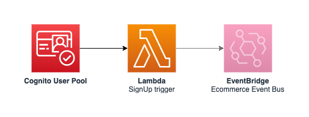

# ACME Shop: Users

Customer accounts and sign-up (Amazon Cognito); announces new customers to the rest of the estate.

- Component: `users` (service, production)
- Owner: **identity-team**
- System: `customer-identity`

## Origin and license

This repository is derived from [aws-samples/aws-serverless-ecommerce-platform](https://github.com/aws-samples/aws-serverless-ecommerce-platform) at commit [`3b9ef36`](https://github.com/aws-samples/aws-serverless-ecommerce-platform/tree/3b9ef36dd3e338c8ab697c2bcb1b672e064e303c), split out of that monorepo with its commit history and modified as listed below. Original code: Copyright 2019 Amazon.com, Inc. or its affiliates, licensed under MIT-0 (see [LICENSE](LICENSE)).

ACME Retail Group is a fictional company used for demos. This repository is not affiliated with, or endorsed by, Amazon Web Services.

## Changes from upstream

- Split out of the upstream monorepo into one repository per service, with history.
- The shared `ecom` library is installed from [acme-shop-ecom-lib](https://github.com/kaku0/acme-shop-ecom-lib) instead of a relative path.
- SSM-backed template parameters have a `dev` default, so the template can be read on its own.
- `catalog-info.yaml` (Backstage) describes ownership, system, APIs and dependencies.
- Domain events are now published with an explicit source and detail-type per event type (one PutEvents call per event).

---

Users service
=============

## API

This service does not define any API.

## Events

See [resources/events.yaml](resources/events.yaml) for a list of available events.

## SSM Parameters

This service defines the following SSM parameters:

* `/ecommerce/${Environment}/users/user-pool/id`: ID of the underlying Cognito User Pool
* `/ecommerce/${Environment}/users/user-pool/arn`: ARN of the underlying Cognito User Pool